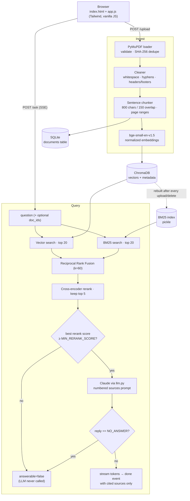

# rag-chat

**Chat with your PDFs: hybrid search, cross-encoder reranking and streamed answers with page-level citations. It says "I don't know" instead of guessing.**

<!-- DEMO GIF PLACEHOLDER: record the app (upload → ask → click a citation chip → toggle debug) and save it as docs/demo.gif, then replace this comment with:  -->
> 📽️ *Demo GIF goes here (`docs/demo.gif`).*

```bash
cp .env.example .env        # add your ANTHROPIC_API_KEY
docker compose up --build   # → http://localhost:8000
```

---

## Features

- **PDF ingestion**: PyMuPDF text extraction per page, cleanup (whitespace, hyphenated line breaks, repeated headers/footers), SHA-256 dedupe, and clear errors for non-PDFs, files over 20 MB and scanned PDFs with no text layer.
- **Sentence-aware chunking**: ~800-character chunks with a 150-character overlap made of whole sentences. Each chunk records `page_start`/`page_end`, so a citation still points at the right pages when the chunk crosses a page break.
- **Hybrid retrieval**: dense search (`BAAI/bge-small-en-v1.5`, cosine, ChromaDB) plus BM25 keyword search, merged with **Reciprocal Rank Fusion** (k = 60).
- **Reranking**: `cross-encoder/ms-marco-MiniLM-L-6-v2` scores the 20 fused candidates; the best 5 go to the LLM.
- **Two-layer "no answer" fallback**: a score gate refuses clearly off-topic questions *without calling the LLM*. The prompt also requires the model to reply exactly `NO_ANSWER` when the sources are insufficient, and the backend maps that to `answerable=false`.
- **Streaming answers over Server-Sent Events**, followed by a final event that carries **only the sources the answer actually cited**.
- **Clickable citations**: `[n]` markers become chips that open a drawer with the file name, page range and the passage, with query terms highlighted.
- **Debug mode**: shows vector, BM25, RRF and rerank scores for every retrieved source, so you can see *why* an answer was (or wasn't) given.
- **Document scoping**: tick documents in the sidebar to restrict a question to them.
- **Measured, not claimed**: `scripts/evaluate.py` compares vector-only, hybrid and hybrid + rerank on a labelled question set.
- **One command to run**: Docker image with both models baked in, persistent `./data` volume and a healthcheck.

## Architecture



<details>
<summary>ASCII version</summary>

```
 Browser (HTML + Tailwind + JS)
        |  upload PDF / ask question (SSE stream)
        v
 FastAPI ------------------------------------------------
   | INGEST                                               | QUERY
   v                                                      v
 PyMuPDF -> clean -> chunk (w/ pages)            embed query (bge prefix)
   |                                              |            |
   v                                              v            v
 embed chunks (bge-small)                   Vector top20   BM25 top20
   |                                              \            /
   v                                            RRF fusion (top 20)
 Chroma (vectors+metadata)                              |
 SQLite (documents)                          Cross-encoder rerank (top 5)
 BM25 (pickle, rebuilt on change)                       |
                                      best score < threshold? -> fallback (no LLM call)
                                                        |
                                      Claude with numbered sources -> NO_ANSWER? -> fallback
                                                        |
                                      stream answer + cited sources [1][2]
```
</details>

## Evaluation

The evaluation indexes two original sample manuals I wrote for this project (`samples/`, generated by `scripts/make_sample_pdf.py`): a 10-page home-battery handbook and an 8-page EV-charger guide. The charger guide is a deliberate **hard distractor**: it covers the same topics (Wi-Fi, warranty, status lights, error code E-214, breakers, installation), so a retriever has to tell the documents apart. `tests/eval_set.json` has **30 answerable questions** labelled with the expected document and page, plus **8 unanswerable ones**. Most questions are paraphrased rather than copied from the text.

```bash
python scripts/evaluate.py          # the table below
python scripts/evaluate.py --sweep  # + per-question rerank scores and a threshold sweep
```

Measured results (28 chunks, CPU, `MIN_RERANK_SCORE=-5.0`):

| Config | Hit@1 | Hit@5 | MRR | Fallback accuracy | Latency / query (CPU) |
|---|---|---|---|---|---|
| Vector only | 0.80 | 0.97 | 0.88 | n/a | 37 ms |
| Hybrid (RRF) | 0.87 | 1.00 | 0.92 | n/a | 39 ms |
| **Hybrid + Rerank** | **1.00** | **1.00** | **1.00** | **0.87** | 413 ms |

- **Hit@k**: the expected (document, page) lies within the page range of one of the top-k chunks. **MRR**: mean of 1/rank of the first such chunk.
- **Fallback accuracy**: share of all 38 questions where the score gate makes the right call (unanswerable → refused, answerable → sent to the LLM). It applies only to the rerank config, because the gate thresholds the rerank score. At -5.0, all 30 answerable questions pass the gate and 3 of 8 unanswerable ones are refused outright. The other 5 (e.g. *"How much does the H2 cost?"*) look on-topic to the reranker and are left to the LLM's `NO_ANSWER` rule.
- Latency is retrieval only (embedding + search + rerank) on a laptop CPU. The reranker costs about 0.4 s per query, which is what buys the perfect Hit@1.

**Caveats, stated plainly:** the corpus is small and synthetic, I wrote both the documents and the questions, and the threshold was tuned on this same set, so the numbers are optimistic and mainly show the *relative* gain of each stage. The evaluation is retrieval-only and makes no LLM calls; the second fallback layer (`NO_ANSWER`) and answer faithfulness are not measured here. See *Future work*.

## Design decisions

| Decision | Why |
|---|---|
| **`bge-small-en-v1.5` embeddings** | Strong retrieval quality for its size (384 dimensions, ~130 MB), fast on CPU, free and local, so documents never leave the machine for embedding. bge is trained with a query instruction, so the prefix `Represent this sentence for searching relevant passages: ` is added to **queries only**, never to passages. |
| **800-character chunks, 150 overlap** | About 150–200 tokens: big enough to hold a full fact with its context, small enough that one chunk is about one thing (a vague match is the usual failure of big chunks). The overlap is made of **whole trailing sentences** totalling ≤150 characters, so a fact that straddles a boundary still appears intact in at least one chunk. Chunks may cross pages, and `page_start`/`page_end` keep citations exact. |
| **Hybrid search + RRF** | Dense vectors handle paraphrases ("power during blackouts" → *Backup Only mode*); BM25 nails exact tokens that embeddings blur (`E-214`, `HB-WM2`, `502`). RRF merges the two by **rank** rather than raw score, so it needs no score normalization or weight tuning across two incomparable scales. k = 60 is the standard value from the original RRF paper. On the eval it lifts Hit@1 from 0.80 to 0.87. |
| **Cross-encoder rerank on 20 candidates** | A cross-encoder reads question and passage together, which is far more precise than comparing two independent embeddings. It is too slow to run over the whole corpus, so it only sees the 20 fused candidates. Hit@1 goes from 0.87 to 1.00. |
| **A score threshold *and* a prompt rule** | Trusting the LLM alone to refuse is unreliable and costs a call per off-topic question. The gate refuses clearly unrelated questions for free. The `MIN_RERANK_SCORE` default of **-5.0** comes from the `--sweep` output: it is the highest threshold that refused **no** answerable question. A wrong refusal cannot be recovered, while a wrong pass is still caught by the `NO_ANSWER` instruction. Stricter values (e.g. -3) refuse more off-topic questions but begin to drop real ones. |
| **LLM behind a `Protocol` (`app/generation/llm.py`)** | `answer_stream` only needs an object with `stream(system, prompt) -> Iterator[str]`. Swapping in OpenAI, a local model or a fake is one class. The Anthropic client uses `claude-sonnet-5-5` (overridable via `LLM_MODEL`), `effort: low` (grounded QA needs little reasoning, and low effort keeps time-to-first-token down), and the server-side refusal fallback for models that support it. |
| **`NO_ANSWER` never reaches the screen** | Streamed output is held back while it could still be the beginning of `NO_ANSWER`, so the user never sees the sentinel flash up before the fallback message replaces it. |
| **BM25 rebuilt from Chroma after every change** | Chroma is the single source of truth for chunks; the pickled BM25 index is derived from it, so it can never drift out of sync. A full rebuild is cheap at this scale. |

### Choices made where the plan was ambiguous

- **Header/footer removal** only considers the first and last two non-empty lines of each page; a line is dropped if it repeats (digits normalized, so `Page 3 of 10` matches `Page 4 of 10`) on more than half the pages. Restricting it to the page edges prevents deleting body lines that merely look alike, such as table rows that differ only by a number.
- **`token_count`** is a model-agnostic estimate (words plus punctuation marks), which keeps the chunker independent of any tokenizer.
- **Extra modules beyond the plan's tree:** `app/index.py` keeps SQLite, Chroma, BM25 and the upload folder consistent under a lock; `app/generation/answer.py` holds the gate, `NO_ANSWER` handling and citation parsing as pure, unit-tested functions.
- **Citation payload:** `Citation` also carries the full chunk `text` (for the drawer) and its four retrieval scores (for debug mode). The SSE `done` event adds a `retrieved` list with every top-k source, so debug mode can explain a refusal too.
- **Citation formats:** `[1]`, `[1][2]` and `[1, 2]` are all parsed; numbers outside the source list are ignored.
- **Uploads** keep the original PDF under `data/uploads/<doc_id>.pdf` so a future PDF viewer can open it. Duplicate uploads (same SHA-256) return the existing document with `duplicate: true`.
- **The Docker container runs as root**, so the `./data` bind mount is writable on Linux hosts, where Docker creates the directory root-owned.
- **No API key:** the app still starts and serves retrieval and the gate. Questions that pass the gate return a clear "No LLM is configured" error. The `FakeLLM` in `tests/fakes.py` is used **only in tests**.
- **Location:** the project lives in the repository root rather than a nested `rag-chat/` folder.

## Running it

### Docker (recommended)

```bash
cp .env.example .env               # set ANTHROPIC_API_KEY
docker compose up --build
```

Open http://localhost:8000. The first build downloads PyTorch (CPU-only wheels) and both models into the image, so later starts are fast and work offline. Indexed data persists in `./data`.

### Local development

Requires Python 3.11+.

```bash
python -m venv .venv
source .venv/bin/activate            # Windows: .venv\Scripts\activate
pip install -r requirements-dev.txt
cp .env.example .env                 # set ANTHROPIC_API_KEY
python scripts/make_sample_pdf.py    # optional: regenerate samples/*.pdf
uvicorn app.main:app --reload
```

Interactive API docs live at http://localhost:8000/docs.

### Tests and evaluation

```bash
pytest                               # 29 tests: chunker, RRF, BM25, gate, NO_ANSWER, citations, API end to end
python scripts/evaluate.py --sweep
```

The API tests use real Chroma, SQLite and BM25 with lightweight fake embedder, reranker and LLM, so they need no network or API key.

## API

| Method | Path | Description |
|---|---|---|
| `POST` | `/upload` | multipart `file` → `{document: DocumentMeta, duplicate: bool}`; `400` with a readable `detail` on invalid input |
| `GET` | `/documents` | list of `DocumentMeta`, newest first |
| `DELETE` | `/documents/{doc_id}` | removes the document from SQLite, Chroma, BM25 and disk; `404` if unknown |
| `POST` | `/ask` | `{question, doc_ids?, top_k?}` → `text/event-stream` |
| `GET` | `/health` | `{status, documents, llm_configured}` |

`/ask` emits these events:

```
event: token   data: {"text": "The H2 is covered for 12 years "}
event: token   data: {"text": "[1]."}
event: done    data: {"answer": "...", "answerable": true,
                      "citations": [{"n": 1, "filename": "...", "page_start": 9, "page_end": 9,
                                     "snippet": "...", "text": "...", "vector_score": 0.71,
                                     "bm25_score": 4.2, "rrf_score": 0.032, "rerank_score": 5.9}],
                      "retrieved": [ ...all top-k sources with scores... ]}
event: error   data: {"message": "The language model timed out. Please try again."}
```

## Configuration

All settings live in `.env` (see `.env.example`) and are read by `pydantic-settings`:

| Variable | Default | Meaning |
|---|---|---|
| `ANTHROPIC_API_KEY` | (empty) | required for generated answers |
| `LLM_MODEL` | `claude-sonnet-5-5` | any Anthropic model id |
| `LLM_MAX_TOKENS` / `LLM_TIMEOUT_S` | `2048` / `60` | generation limits |
| `EMBED_MODEL` / `RERANK_MODEL` | bge-small / MiniLM-L-6 | swap models (the Docker image bakes in the defaults) |
| `CHUNK_SIZE` / `CHUNK_OVERLAP` | `800` / `150` | characters |
| `TOP_K` / `CANDIDATES` / `RRF_K` | `5` / `20` / `60` | retrieval sizes |
| `MIN_RERANK_SCORE` | `-5.0` | gate threshold (cross-encoder logit) |
| `MAX_UPLOAD_MB` | `20` | upload limit |
| `DATA_DIR` | `./data` | where Chroma, SQLite, BM25 and uploads live |

## Project structure

```
app/
  main.py               FastAPI app factory, routes, SSE, static files
  config.py             pydantic-settings
  schemas.py            Pydantic v2 models
  db.py                 SQLite documents table
  index.py              ingest/delete orchestration (keeps all stores consistent)
  ingest/               loader.py · cleaner.py · chunker.py
  retrieval/            embedder.py · vector_store.py · bm25_store.py · hybrid.py · reranker.py
  generation/           prompt.py · llm.py · answer.py
  static/               index.html · app.js
scripts/                make_sample_pdf.py · evaluate.py
samples/                generated demo PDFs (original text)
tests/                  test_chunker.py · test_retrieval.py · test_api.py · fakes.py · eval_set.json
```

## Limitations

- **Scanned PDFs are rejected**: there is no OCR. Tables and multi-column layouts are flattened to plain text in reading order.
- **Single user, no auth**: anyone who can reach the port can upload and delete documents.
- **English-oriented**: bge-small-en and the MiniLM reranker are English models.
- **The rerank threshold is corpus-dependent**: cross-encoder logits shift with the domain, so re-run `evaluate.py --sweep` on your own labelled questions.
- **Each question stands alone**: there is no conversation memory, so follow-ups like "and what about the charger?" are not rewritten.
- **BM25 is rebuilt in full** on every change. That's fine for hundreds of documents; beyond that it should become incremental.

## Future work

- OCR fallback for scanned pages (e.g. Tesseract via PyMuPDF), and table-aware extraction.
- End-to-end evaluation of generated answers: faithfulness and citation precision with an LLM judge, plus refusal accuracy of the `NO_ANSWER` layer.
- Query rewriting for follow-up questions (conversation memory).
- An in-app PDF viewer (PDF.js) that jumps to and highlights the cited passage.
- Multi-user workspaces with authentication; multilingual models (`bge-m3`).
- A larger, public evaluation corpus with held-out threshold tuning.
