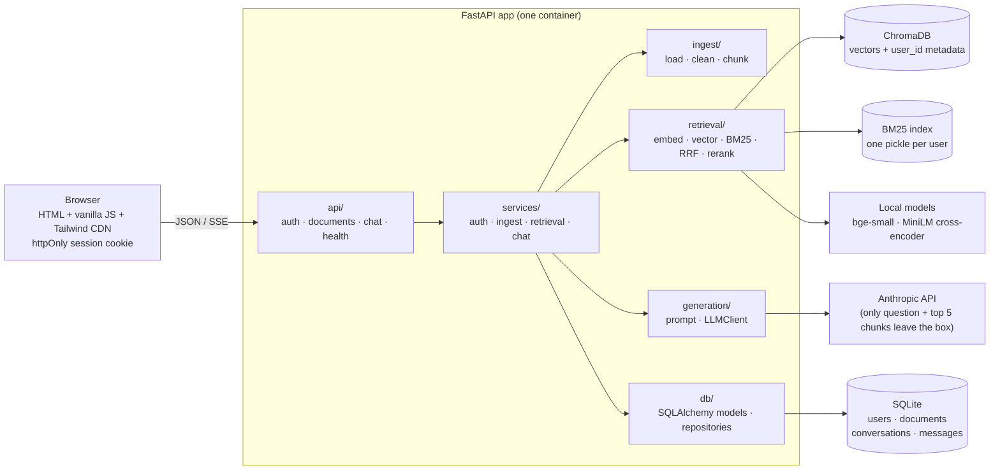

# rag-chat

**Chat with your PDFs. Answers stream in with clickable `[1][2]` citations to the exact page, and when the documents don't contain the answer, it says so instead of guessing.**

<!-- DEMO GIF PLACEHOLDER: record "Try it with a sample PDF" → click a sample question → click a [1] chip → toggle "Show retrieval scores", save as docs/demo.gif, and replace this comment with:  -->
> 📽️ *Demo GIF goes here (`docs/demo.gif`).*

```bash
cp .env.example .env
docker compose up --build      # → http://localhost:8000, click "Try it with a sample PDF"
```

---

## Features

- **Sign in or try as a guest.** Email + password accounts (argon2id, httpOnly cookie sessions), or one click into a guest account that already has a sample PDF indexed. Guest data is deleted after 24 hours.
- **Upload with visible progress:** Reading → Splitting → Understanding → Ready, with friendly errors for non-PDFs, files over 20 MB, scanned PDFs without text, and duplicates.
- **Hybrid retrieval:** dense vectors (`bge-small-en-v1.5`, Chroma) plus BM25 keywords, merged with Reciprocal Rank Fusion, then reranked by a cross-encoder.
- **Grounded, cited, streamed answers** over Server-Sent Events. Inline `[n]` chips open a source drawer with the file, page range and the passage, with your question's words emphasized.
- **Two-layer "I couldn't find this":** a relevance gate refuses off-topic questions *without calling the LLM*, and the prompt makes the model reply `NO_ANSWER` when the sources aren't enough.
- **Per-user isolation:** every vector and keyword search is filtered by user, and this is covered by tests.
- **Conversation history** with rename and delete; scope questions to selected documents ("Searching 2 of 3 documents").
- **Bring your own API key:** each user pastes an Anthropic key in Settings, it's tested instantly (free Models API call), and it's never stored on the server. An optional offline mode (`LLM_PROVIDER=fake`) answers extractively with no key at all.
- **Transparent retrieval:** a debug switch shows vector, BM25, RRF and rerank scores for every source.
- **Design system:** warm-paper and teal tokens, light and dark themes, WCAG AA contrast checked by a script, keyboard shortcuts, visible focus, reduced motion respected, usable at 360 px. See [`/static/styleguide.html`](app/static/styleguide.html).
- **Measured, not claimed:** `scripts/evaluate.py` compares vector-only, hybrid and hybrid + rerank on a labelled question set.

## Architecture



**Layering rule:** `api → services → (ingest | retrieval | generation | db)`. Lower layers never import upper ones, and services never import FastAPI. That's what lets tests swap in fake models and a `FakeLLM`.

**Ask flow:** question → embed (bge query prefix) → vector top 20 + BM25 top 20, both filtered by `user_id` → RRF (k = 60) → cross-encoder rerank → top 5 → **gate** (best rerank score < `MIN_RERANK_SCORE` → "couldn't find this", no LLM call) → numbered-sources prompt → stream tokens → parse `[n]` → `citations` event → persist → `done`.

**Ingest flow:** upload → validate (`%PDF` magic bytes, size, per-user SHA-256 dedupe, quota) → row `processing` → background task: extract → clean → chunk (800/150, page ranges) → embed in batches → Chroma → rebuild that user's BM25 → row `ready`. The UI polls `/documents/{id}/status`.

## Evaluation

The corpus is two original manuals written for this project and generated by `scripts/make_sample_pdf.py`:
- a 10-page home-battery handbook;
- an 8-page EV-charger guide, a deliberate **hard distractor** that covers the same topics (Wi-Fi, warranty, status lights, the same error code `E-214`).

`tests/eval_set.json` has **30 answerable questions** labelled with the expected document and page, plus **8 unanswerable** ones. Most questions are paraphrased rather than copied from the text.

```bash
python scripts/evaluate.py          # the table below
python scripts/evaluate.py --sweep  # + per-question rerank scores and a threshold sweep
```

Measured output (28 chunks, laptop CPU, `MIN_RERANK_SCORE=-5.0`):

| Config | Hit@1 | Hit@5 | MRR | Fallback accuracy | Latency / query (CPU) |
|---|---|---|---|---|---|
| Vector only | 0.80 | 0.97 | 0.88 | n/a | 9 ms |
| Hybrid (RRF) | 0.93 | 1.00 | 0.95 | n/a | 10 ms |
| Hybrid + Rerank | 1.00 | 1.00 | 1.00 | 0.87 | 145 ms |

- **Hit@k**: the expected (document, page) is within a top-k chunk's page range. **MRR**: mean of 1/rank of the first such chunk.
- **Fallback accuracy**: share of all 38 questions where the gate makes the right call (unanswerable → refused, answerable → sent to the LLM). It applies only to the rerank config, because the gate thresholds the rerank score. At -5.0, all 30 answerable questions pass and 3 of 8 unanswerable ones are refused outright. The other 5 (e.g. "How much does the H2 cost?") look on-topic to the reranker, so they are left to the LLM's `NO_ANSWER` rule.
- **Latency** is retrieval only (embedding, search, rerank).

**Caveats:** the corpus is small and synthetic, I wrote both the documents and the questions, and the threshold was tuned on the same set. Read the numbers as the *relative* gain of each stage, not as a benchmark. The evaluation never calls the LLM, so the `NO_ANSWER` layer and answer faithfulness are not measured here.

## Design decisions

| # | Decision | Why |
|---|---|---|
| 1 | **Hybrid + rerank over vector-only** | Measured above. Vectors handle paraphrases ("power during blackouts" → *Backup Only mode*); BM25 nails exact tokens (`E-214`, `HB-WM2`, port `502`). The cross-encoder reads question and passage together and fixes the remaining ordering errors. |
| 2 | **Local embeddings (`bge-small-en-v1.5`)** | Privacy and zero cost: documents never leave the machine for embedding. 384 dimensions, fast on CPU, strong for its size. The bge query prefix is added to queries only. |
| 3 | **SQLite + Chroma** | Zero ops for a single container. SQLAlchemy 2.0 means Postgres is a one-line `DATABASE_URL` change. |
| 4 | **httpOnly cookie over a localStorage JWT** | Scripts (including XSS) can't read the session. SameSite=Lax plus a required `X-Requested-With: fetch` header on every state-changing request blocks CSRF; no CORS is enabled. |
| 5 | **Threshold before the LLM** | Cheaper and more reliable than prompt-only refusal. -5.0 is the highest value in the `--sweep` that refused **no** answerable question. A wrong refusal can't be recovered, but a wrong pass is still caught by `NO_ANSWER`. |
| 6 | **No JS framework** | No build step; a reviewer can read `app/static/js/` in minutes. ES modules: `api`, `state`, `ui`, `chat`, `app`. |
| 7 | **800-character chunks, 150 overlap** | About 150–200 tokens: one fact plus its context. The overlap is made of whole trailing sentences, so facts on a boundary stay intact. Chunks may cross pages and record `page_start`/`page_end`. |
| 8 | **RRF, k = 60** | Merges by rank, so there's no need to normalize two incomparable score scales or tune weights. 60 is the standard value. |

### Choices made where the documents were ambiguous or conflicted

- **BM25+ instead of BM25Okapi.** Per-user indexes can be tiny, and Okapi's IDF goes negative when a term is in most chunks. A single-chunk document scored below zero and was never returned (a test caught it). `rank_bm25`'s BM25+ keeps IDF positive. Because its BM25+ adds the same offset to every chunk, `search` only returns chunks that contain a query term. This also lifted hybrid Hit@1 from 0.87 to 0.93.
- **Users bring their own API key** (an explicit owner request after the plan was written). The key lives in the browser (session storage, or local storage if "Remember" is ticked), travels in an `X-Anthropic-Api-Key` header, and is used for that request only. The server never stores or logs it. `ANTHROPIC_API_KEY` in `.env` is an optional shared fallback. Because modals are reserved for destructive confirms, the key form lives in the **Settings** drawer.
- **Offline provider** (`LLM_PROVIDER=fake`): the same `FakeLLM` the tests use, made extractive (it picks the sentences of source 1 that best match the question), so the full UI works with no key. The architecture lists `FakeLLM` for "tests/offline".
- **Ingest stages** are tracked in memory per document; `documents.status` stays `processing | ready | failed` as specified. A restart loses the percentage, not the status.
- **Extra modules:** `app/errors.py` (domain errors mapped to `{"error": {"code", "message"}}`), `app/logging_setup.py` (JSON logs with a request id), `app/services/container.py` (wires everything once), `app/services/rate_limit.py`, and `app/generation/factory.py`.
- **`POST /llm/check`** (not in the API table) backs the Settings "Save and test" button and the status dot.
- **Contrast fixes.** `scripts/check_contrast.py` failed three light-theme pairs, so token values were adjusted rather than the rule: accent `#B45309 → #A14A07` and success `#2F7D4F → #286B44`. A `--color-border-input` token was added because the decorative border tokens can't meet WCAG 1.4.11's 3:1 for input outlines. Dark `success-subtle` and `danger-subtle` weren't specified, so they were defined.
- **`requirements.lock`** is resolved for the container target (CPython 3.11, Linux) by `scripts/lock.py`. A plain `pip freeze` from the dev machine (Python 3.12) pinned `networkx==3.7`, which doesn't install on 3.11.
- **Docker runs as root** so the `./data` bind mount is writable on Linux hosts, where Docker creates it root-owned.
- **Conversation-aware query rewriting** (optional in the architecture) is not implemented; each question is retrieved on its own.

## Run it

### Docker

```bash
cp .env.example .env
docker compose up --build
```

Open http://localhost:8000 and click **Try it with a sample PDF**, or create an account. For written answers, open **Settings** and paste your Anthropic API key (a green dot means it works). For a public deployment, set `APP_ENV=prod` and a random `SECRET_KEY`; the app refuses to start with a placeholder. Serve it over HTTPS.

### Local development

Python 3.11+.

```bash
python -m venv .venv
source .venv/bin/activate            # Windows: .venv\Scripts\activate
pip install -r requirements-dev.txt
cp .env.example .env
uvicorn app.main:app --reload        # http://localhost:8000, API docs at /docs
```

Offline demo with no key: `LLM_PROVIDER=fake uvicorn app.main:app`.

### Checks

```bash
ruff check . && ruff format --check .
pytest -W error::DeprecationWarning       # 48 tests: unit, integration, isolation
python scripts/check_contrast.py          # WCAG AA for every token pair, both themes
python scripts/evaluate.py                # retrieval comparison table
grep -rni gradient app/static             # must print nothing
```

CI (`.github/workflows/ci.yml`) runs lint, contrast, the no-gradient check and the tests on every push.

## API

| Method | Path | Purpose |
|---|---|---|
| POST | `/auth/register`, `/auth/login`, `/auth/guest`, `/auth/logout` | sessions (httpOnly cookie) |
| GET | `/auth/me` | current user |
| POST | `/documents` | upload a PDF (multipart) → `202` with `status: processing` |
| GET | `/documents` | the user's documents |
| GET | `/documents/{id}/status` | `{status, stage, progress, error}` |
| DELETE | `/documents/{id}` | removes the row, chunks, BM25 entries and file |
| POST | `/chat/ask` | SSE: `token`*, `citations`, `done` (or `error`) |
| GET / PATCH / DELETE | `/conversations`, `/conversations/{id}` | history, rename, delete |
| POST | `/llm/check` | does the browser's (or server's) key work? |
| GET | `/health` | database and model status |

Every error has the shape `{"error": {"code": "...", "message": "human readable"}}`. Other users' resources return **404**. State-changing requests need `X-Requested-With: fetch`. Rate limits: 5/min/IP on `/auth/*` and 20/min/user on `/chat/ask`.

## Project structure

```
app/
  api/          auth.py documents.py chat.py health.py deps.py
  services/     auth_service.py ingest_service.py retrieval_service.py chat_service.py container.py rate_limit.py
  ingest/       loader.py cleaner.py chunker.py
  retrieval/    embedder.py vector_store.py bm25_store.py hybrid.py reranker.py
  generation/   prompt.py llm_base.py llm_anthropic.py llm_fake.py factory.py
  db/           models.py session.py repositories.py
  static/       index.html styleguide.html css/{tokens,components}.css js/{api,state,ui,chat,app}.js
  main.py config.py schemas.py errors.py logging_setup.py
tests/          test_chunker.py test_retrieval.py test_api.py conftest.py fakes.py eval_set.json
scripts/        evaluate.py check_contrast.py make_sample_pdf.py lock.py
```

## Limitations

- **Scanned PDFs are rejected** (no OCR). Tables and multi-column layouts are flattened to plain text.
- **Single process:** rate limits and ingest progress are in memory, so they reset on restart and aren't shared across workers.
- **English models:** bge-small-en and the MiniLM reranker are English-only.
- **The rerank threshold is corpus-dependent:** re-run `evaluate.py --sweep` on your own labelled questions.
- **No query rewriting:** follow-up questions like "and the charger?" are not made standalone.
- **chromadb 1.5.9 has open advisories:** `pip-audit` reports PYSEC-2026-311, -3813, -3814 and -3815, with no fixed release listed at the time of writing. Chroma runs embedded here (no Chroma server port is exposed), but upgrade as soon as a fix ships.
- **Tailwind's Play CDN** is documented as "for development purposes only". Tailwind is used only for layout utilities here; all visual styling is in the token-based CSS.

## Future work

1. Conversation-aware query rewriting for follow-ups, with tests.
2. End-to-end answer evaluation (faithfulness, citation precision, `NO_ANSWER` accuracy) with an LLM judge.
3. Alembic migrations, Postgres, and Redis-backed rate limits/progress for multi-worker deploys.
4. OCR fallback for scanned pages; an in-app PDF viewer that jumps to the cited page.
