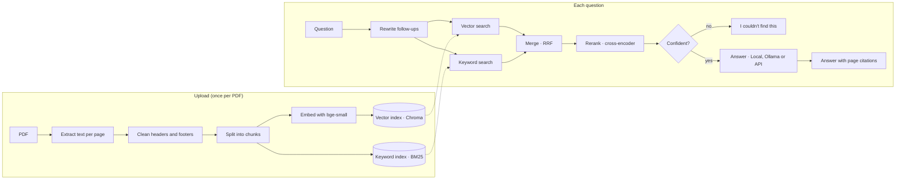

<p align="center">
  <picture>
    <source media="(prefers-color-scheme: dark)" srcset="assets/brand/wordmark-dark.svg">
    
  </picture>
</p>

<p align="center">
  <strong>Chat with your PDFs and turn them into study notes.<br>
  Every answer cites the exact page, and it works fully offline with no API key.</strong>
</p>

<p align="center">
  <a href="https://github.com/ChandanKarlekarV/rag-chat/actions/workflows/ci.yml"></a>
  
  
  
  
</p>

---

rag-chat is a retrieval-augmented generation (RAG) app for your own documents. Upload PDFs, including books of 500+ pages, and ask questions. Answers come only from your documents, each with a link to the page it came from. When the documents don't contain the answer, it says so instead of guessing. The **Study** tab turns any PDF into short notes, sticky notes, a mind map, diagrams, key terms and flashcards.

## Highlights

- **Works without an API key.** A local question-answering model finds the answer in your PDF and quotes it word for word, with the page. Nothing leaves your machine.
- **Accurate on large books.** On a 527-page handbook with an independent answer key: **81/81 answers correct with the right page**, and **12/12** questions about things not in the book refused.
- **Fast.** A 500-page PDF is indexed in **3–10 seconds** on a laptop GPU, and answers take about **0.2 seconds**.
- **Optional LLM answers.** Use [Ollama](https://ollama.com) on your own computer, or paste an API key from **Anthropic, OpenAI, Google Gemini, Groq, OpenRouter, Mistral, DeepSeek or xAI**. The key stays in your browser.
- **Study material with diagrams.** Short notes, sticky notes, a mind map, flowcharts and if-then diagrams, key terms and flashcards, printed on a white page with one colour per topic. Everything an LLM writes is checked against the page it cites.
- **Built like a real service.** Accounts and guest mode, per-user data isolation, rate limits, CSRF protection, database migrations, Postgres/Redis/Chroma for multiple workers, Docker, CI, and 122 tests.

## Quick start

### Windows

One-time setup (Python 3.11 or newer):

```bash
python -m venv .venv
.venv\Scripts\pip install -r requirements-dev.txt
copy .env.example .env
```

Then double-click **`Start rag-chat.bat`**. It starts the app in the background, waits until the models are loaded (20–40 seconds the first time) and opens http://127.0.0.1:8000. **`Stop rag-chat.bat`** stops it and frees all CPU, RAM and GPU memory.

### macOS / Linux

```bash
python -m venv .venv && source .venv/bin/activate
pip install -r requirements-dev.txt
cp .env.example .env
uvicorn app.main:app      # http://localhost:8000, API docs at /docs
```

The first start downloads the models from Hugging Face (about 2.5 GB). After that it runs offline.

### Docker

```bash
cp .env.example .env
docker compose up --build
```

Then open the app and click **Try it with a sample PDF**, or create an account.

<details>
<summary><strong>Use an NVIDIA GPU (recommended: about 10× faster)</strong></summary>

The default install uses CPU-only PyTorch. Install the CUDA build of the same version into the virtual environment (about 3 GB):

```bash
pip install --force-reinstall --no-deps "torch==2.15.0" --index-url https://download.pytorch.org/whl/cu132
```

Leave `DEVICE=auto`. `/health` reports `"device": "cuda"` when the GPU is in use. Tested on an RTX 5070 Laptop GPU.
</details>

## Answer modes

Pick a mode with the switch above the question box. Unavailable modes are disabled, with the reason.

| Mode | Needs | What you get | Speed (laptop GPU) |
|---|---|---|---|
| **Local** (default) | nothing | The exact answer quoted from your PDF, plus supporting sentences and the page. Refuses when unsure. | ~0.2 s |
| **Ollama** | [Ollama](https://ollama.com) + `ollama pull llama3.2` | A written answer from a model on your computer, with citations | ~8–10 s |
| **API key** | a key from any supported provider | A written, summarised answer from your provider's model, with citations | provider-dependent |

All three use the same retrieval and the same "I couldn't find this" check, so only the final wording differs. The automatic choice is: API key if one is set, else Ollama if it's running, else Local.

## Study material

In the **Study** tab, pick a document and what you want:

| Output | Made from |
|---|---|
| **Short notes** | The key points of each chapter, within a fixed budget so a 500-page book still gets short notes |
| **Sticky notes** | The most important facts, colour-coded by chapter |
| **Mind map** | Chapters → subsections or key phrases, as a two-sided diagram |
| **Flowchart** | Numbered lists and procedures ("To restart, switch off…, wait…, then…") |
| **If-then diagrams** | Rules like "When the grid fails, …" or "A red light means …" |
| **Key terms** | Definitions and acronyms in the document |
| **Flashcards** | Definitions and fill-in-the-blank facts |

Every item shows its page. Local mode quotes the document and takes a few seconds. Ollama and API key mode rewrite the material in plainer words, and every item they write must match its cited page (numbers, names and wording) or it is dropped. You can download everything as Markdown or print it.

## How it works



1. **Ingest.** PyMuPDF extracts each page's text. Repeated headers and footers are removed. The text is split into ~800-character chunks with overlap and embedded with `BAAI/bge-small-en-v1.5`. Chunks go into a vector index (meaning) and a BM25 index (exact words), both kept separately for each user.
2. **Retrieve.** The top 20 chunks by meaning and the top 20 by keyword are merged with Reciprocal Rank Fusion, then a cross-encoder (`ms-marco-MiniLM-L-6-v2`) re-scores them and keeps the best 5.
3. **Gate.** If even the best chunk scores too low, the app answers "I couldn't find this in your documents" without calling any model.
4. **Answer.** In Local mode, `deepset/deberta-v3-large-squad2` selects the exact answer span. The answer must have the right type (a price must contain money, "how many" a number, "who is the CEO" a sentence about the CEO), and every name in the question must appear in the passage. In LLM modes, the model gets the numbered passages, is told to treat them as data, and must answer `NO_ANSWER` when they aren't enough.
5. **Cite.** Answers stream to the browser with `[n]` links. Each link opens the passage with the answer highlighted, plus the file and page.

More detail: [docs/DESIGN_DECISIONS.md](docs/DESIGN_DECISIONS.md) and [docs/ARCHITECTURE.md](docs/ARCHITECTURE.md).

## Accuracy and speed

Measured on a laptop with an RTX 5070 GPU, Local mode, no API key. Each script below reproduces its row.

| Test | Questions | Correct (fact and page) | Refused when not in the documents | Speed |
|---|---|---|---|---|
| Two product manuals, one a deliberate distractor (`scripts/evaluate.py`) | 30 | **30/30** | **8/8** | 0.14 s per answer |
| Held-out questions, written after tuning | 14 | **14/14** | **4/4** | 0.16 s per answer |
| 527-page handbook with an independent answer key (`scripts/evaluate_long.py --pdf … --answers …`) | 81 | **81/81** | **12/12** | indexed in 8–10 s; 0.2 s per answer |
| 520-page generated almanac (`scripts/evaluate_long.py`) | 40 | **40/40** | **6/6** | indexed in 3 s; 0.15 s per answer |

Study material for the 527-page handbook takes about 7 seconds in Local mode. It covers all 27 chapters in 54 points (about 730 words), and 39 of those points are the book's key facts.

These test documents are synthetic, and no system is right on every PDF. What Local mode guarantees is narrower: it only quotes your document, shows you the page so you can check, and declines when it isn't confident. Full method, all tables and what each test changed: [docs/EVALUATION.md](docs/EVALUATION.md).

## Configuration

Settings come from environment variables or `.env` (see [`.env.example`](.env.example)). The most useful ones:

| Variable | Default | Purpose |
|---|---|---|
| `DEVICE` | `auto` | `auto` uses an NVIDIA GPU when present, else the CPU; or `cuda` / `cpu` |
| `TORCH_THREADS` | `0` | Cap on CPU threads used by the models (0 = all cores) |
| `QA_MODEL` | `deepset/deberta-v3-large-squad2` | Local answer model; `deepset/roberta-base-squad2` is lighter |
| `OLLAMA_BASE_URL` / `OLLAMA_MODEL` | `http://localhost:11434` / `llama3.2` | Ollama mode |
| `ANTHROPIC_API_KEY` or `LLM_API_KEY` + `LLM_PROVIDER` | empty | Optional shared server key (users can also paste their own in Settings) |
| `MIN_RERANK_SCORE` | `-5.0` | The "I couldn't find this" threshold |
| `MAX_UPLOAD_MB` | `100` | Largest PDF accepted |
| `DATABASE_URL`, `REDIS_URL`, `CHROMA_URL` | empty | Postgres, Redis and a Chroma server for multi-worker deployments |
| `APP_ENV`, `SECRET_KEY` | `dev` | Set `APP_ENV=prod` and a random 32+ character `SECRET_KEY` for any public deployment |

Multi-worker setup with Postgres, Redis and a Chroma server: `docker compose -f docker-compose.yml -f docker-compose.scale.yml up --build`.

## API

Interactive docs are at `/docs` while the app runs.

| Method | Path | Purpose |
|---|---|---|
| POST | `/auth/register`, `/auth/login`, `/auth/guest`, `/auth/logout` | Sessions (httpOnly cookie) |
| POST / GET / DELETE | `/documents`, `/documents/{id}` | Upload, list and delete PDFs |
| GET | `/documents/{id}/status` | Ingest progress |
| POST | `/chat/ask` | Ask a question; streams Server-Sent Events: `mode`, `token`, `citations`, `done` |
| GET | `/chat/modes` | Available answer modes and providers |
| POST | `/chat/test-key` | Check a pasted API key for free by listing its models |
| POST | `/study` | Study material for a document |
| GET / PATCH / DELETE | `/conversations`, `/conversations/{id}` | Conversation history |
| GET | `/health` | Database, models and device status |

Errors always have the shape `{"error": {"code": "...", "message": "..."}}`. State-changing requests need the header `X-Requested-With: fetch`.

## Project structure

```
app/
  api/          HTTP routes: auth, documents, chat, study, health
  services/     business logic: ingest, retrieval, chat, study, auth, rate limits
  ingest/       PDF loading, cleaning, chunking, outline detection
  retrieval/    embeddings, Chroma, BM25, fusion, reranking
  generation/   answer modes (local reader, Ollama, API providers), study builders
  db/           SQLAlchemy models and repositories
  static/       the web UI (HTML, CSS design tokens, vanilla JS)
migrations/     Alembic database migrations
scripts/        evaluation, sample PDF generators, contrast check, Windows launchers
tests/          unit, API, isolation and backend tests, evaluation question sets
docs/           architecture, design system, decisions, evaluation
```

Layering rule: `api → services → (ingest | retrieval | generation | db)`. Lower layers never import upper ones.

## Development

```bash
ruff check . && ruff format --check .     # lint and format
pytest -W error::DeprecationWarning       # 122 tests
python scripts/check_contrast.py          # WCAG AA contrast for every colour token, both themes
python scripts/evaluate.py                # retrieval and answer accuracy
python scripts/evaluate_long.py           # 520-page scale test
python scripts/evaluate_long.py --pdf my.pdf --answers my_key.json --misses   # your own PDF and answer key
```

Tests use fakes for the models and `fakeredis` by default. Set `TEST_DATABASE_URL`, `TEST_REDIS_URL` and `TEST_CHROMA_URL` to also run against real servers; CI does this for Postgres and Redis.

## Security and privacy

- With no API key, nothing leaves your machine: models run locally and documents stay in `data/`.
- In LLM modes, only the question and the top 5 passages are sent to the provider. A pasted key stays in the browser, travels per request in a header, and is never stored or logged by the server (covered by tests).
- Passwords use argon2id. Sessions are httpOnly, SameSite cookies. State-changing requests need a CSRF header, and CORS is off.
- Every search is filtered by user, and other users' resources return 404.
- Document text is treated as untrusted data in every LLM prompt.

## Limitations

- Scanned PDFs (images of text) are rejected: there is no OCR yet. Tables and multi-column layouts are read as plain text.
- The models are English-only.
- Local mode quotes rather than explains. For written summaries or answers that combine several passages, use Ollama or an API key.
- On CPU only, answers take about 1.5 s; set `QA_MODEL=deepset/roberta-base-squad2` for speed.
- `chromadb` 1.5.9 has open advisories with no fixed release yet; upgrade when one ships.

## Documentation

- [docs/EVALUATION.md](docs/EVALUATION.md): how accuracy and speed are measured, with every result
- [docs/DESIGN_DECISIONS.md](docs/DESIGN_DECISIONS.md): why it's built this way, and experiments that lost
- [docs/ARCHITECTURE.md](docs/ARCHITECTURE.md): the original architecture spec
- [docs/DESIGN_SYSTEM.md](docs/DESIGN_SYSTEM.md): colours, typography and components (live at `/static/styleguide.html`)
- [docs/ANSWER_MODES.md](docs/ANSWER_MODES.md): the answer-modes spec

## License and credits

Released under the [MIT License](LICENSE).

- Answer model: [`deepset/deberta-v3-large-squad2`](https://huggingface.co/deepset/deberta-v3-large-squad2), CC BY 4.0
- Embeddings: [`BAAI/bge-small-en-v1.5`](https://huggingface.co/BAAI/bge-small-en-v1.5)
- Reranker: [`cross-encoder/ms-marco-MiniLM-L-6-v2`](https://huggingface.co/cross-encoder/ms-marco-MiniLM-L-6-v2)
- The sample manuals and test books are original and generated by the scripts in `scripts/`.
