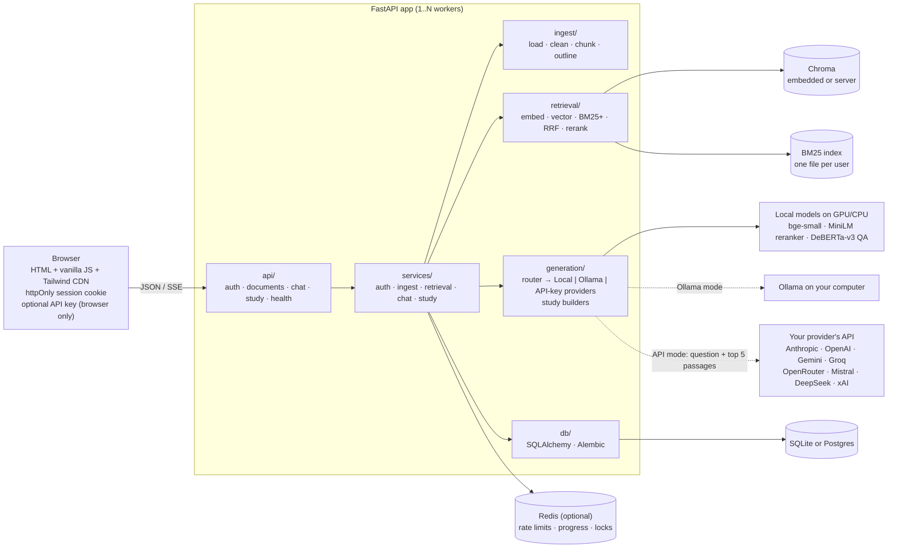

<p align="center">
  <picture>
    <source media="(prefers-color-scheme: dark)" srcset="assets/brand/wordmark-dark.svg">
    
  </picture>
</p>

<p align="center"><strong>Chat with your PDFs. Every answer links to the exact page it came from, and when the documents don't contain the answer, it says so instead of guessing. Works with no API key.</strong></p>

<!-- DEMO GIF PLACEHOLDER: record "Try it with a sample PDF" → click a sample question → click a [1] chip → ask a follow-up → toggle "Show retrieval scores", save as docs/demo.gif, and replace this comment with:  -->
> 📽️ *Demo GIF goes here (`docs/demo.gif`).*

```bash
cp .env.example .env
docker compose up --build      # → http://localhost:8000, click "Try it with a sample PDF"
```

---

## Features

- **Three answer modes, one switch.** A segmented control above the question box: **Local · no key** / **Ollama** / **API key**. Unavailable modes are disabled, with the reason and a "Set up" link. Auto-selection: an API key is available → API key mode; else Ollama is reachable → Ollama; else Local. Your choice is saved to your account.
  - **Local (default, no key, no internet):** an extractive QA model (`deepset/deberta-v3-large-squad2`) finds the exact answer span in your PDF and shows it with up to three supporting sentences, **all quoted word for word** with page citations. It cannot invent text, and it says "I couldn't find this" when it isn't confident.
  - **Ollama (optional):** fluent answers from a model running on your own computer. Free and private.
  - **API key — any provider:** written, summarised answers from **Anthropic (Claude), OpenAI, Google Gemini, Groq, OpenRouter, Mistral, DeepSeek or xAI**. Paste a key in Settings: the provider is detected from the key (or chosen from a list), the key is checked for free by listing its models, and you pick the model. The key stays in your browser and is never stored or logged by the server. A server-wide key can be set with `ANTHROPIC_API_KEY` or `LLM_API_KEY` + `LLM_PROVIDER`.
- **Study material from any PDF** (the **Study** tab): pick a document and what you want, and get **short notes, sticky notes, a mind map, flowcharts of step-by-step procedures, key terms and flashcards**, each item tagged with its page. Output is printed on a white sheet with one soft color per topic (section). Diagrams are added where the document calls for them: numbered lists and one-sentence procedures ("To restart the system, switch off…, wait…, then…") become flowcharts, and "When X, …" / "A solid red light means …" sentences become if-this-then-that diagrams, shown inside the notes of their section and in the Flowchart tab. Local mode needs no key and takes about a second: it quotes the most central sentences of each section word for word (chosen with the embedding model), finds key terms from definitions and acronyms, and draws processes from numbered lists. Ollama or API key mode rewrites the same page-tagged excerpts in plainer words; anything the model returns that can't be read falls back to the local version, and page numbers the model invents are dropped. Download it all as Markdown or print it. Measured on the 10-page sample with the RTX 5070 Laptop GPU: Local 1.2 s; Ollama `llama3.2`, all six kinds (one request per kind, Ollama's JSON mode) 79 s, with 5 of 6 kinds written by the model and the flowchart falling back to local (the sample has no procedure). An Ollama chat answer took 7.5–10.6 s. API-key mode was checked against the real OpenAI, Gemini, Groq and Anthropic endpoints with invalid keys (each rejected with a clear message); it has not been run with a valid key here.
- **Same retrieval and the same "I couldn't find this" gate in every mode.** Only the last step (turning passages into an answer) differs, so accuracy stays comparable and hallucination stays low.
- **Honest labels:** every answer shows *Extractive · quoted from your document* or *Generated by …*, Local answers show confidence in words (High / Medium / Low match), and the source drawer highlights the exact extracted span.
- **Runs on your GPU:** the local models (embeddings, reranker, QA reader) use an NVIDIA GPU automatically when one is available (`DEVICE=auto`), and `TORCH_THREADS` caps CPU use.
- **Follow-up questions just work:** "How long is the warranty?" → "Can it be transferred?" becomes a standalone search (rewritten by Claude or Ollama in those modes, by a keyword heuristic in Local mode). The UI shows what it searched for.
- **Hybrid retrieval:** dense vectors (`bge-small-en-v1.5`, Chroma) plus BM25+ keywords, merged with Reciprocal Rank Fusion, then reranked by a cross-encoder.
- **Sign in or try as a guest:** email and password (argon2id, httpOnly cookie sessions), or one click into a guest account with a sample PDF already indexed. Guest data is deleted after 24 hours.
- **Visible upload progress** (Reading → Splitting → Understanding → Ready), friendly errors, retry for failed files, and per-user duplicate detection.
- **Per-user isolation:** every vector and keyword search is filtered by user, and this is covered by tests.
- **Conversation history** with rename and delete; each answer is stored with the mode that produced it.
- **Scales out:** Alembic migrations, Postgres, and Redis-backed rate limits, upload progress and locks, plus a Chroma server for running several workers (`docker-compose.scale.yml`).
- **Design system:** a "notebook" palette (warm paper, graphite ink, fountain-pen blue, highlighter yellow), light and graphite-dark themes; study output on a white sheet with eight soft topic colors (one per section, with a legend), WCAG AA contrast checked by a script, keyboard shortcuts, reduced motion respected, usable at 360 px. See [`/static/styleguide.html`](app/static/styleguide.html).
- **Measured, not claimed:** `scripts/evaluate.py` (free, no key) and `scripts/judge.py` (LLM-as-judge, needs a key).

## Architecture



**Layering rule:** `api → services → (ingest | retrieval | generation | db)`. Lower layers never import upper ones; services never import FastAPI, and the chat service never imports a concrete provider (the router in `generation/router.py` builds them).

**Ask flow:**
1. Pick the mode: the one requested, else the saved default, else auto-selection.
2. Follow-up? Rewrite it into a standalone query.
3. Embed the query (with bge's query prefix).
4. Search vectors (top 20) and BM25 (top 20), both filtered by `user_id`.
5. Merge with RRF (k = 60), then rerank with the cross-encoder and keep the top 5.
6. **Gate (all modes):** if the best rerank score is below `MIN_RERANK_SCORE`, answer "couldn't find this" with no model call.
7. Answer with the provider:
   - **Local:** the QA model picks the best span. Score = `0.6 × qa_score + 0.4 × normalised rerank score`, and the span must have the type the question asks for. It is used only if `qa_score ≥ MIN_QA_SCORE`; the cross-encoder then picks supporting sentences, and the answer is composed from templates. "Summarize" questions get an excerpt summary and "why / compare" questions get supporting sentences, each with a hint to switch mode for a written answer.
   - **Ollama / Claude:** a numbered-sources prompt that treats sources as untrusted data, with a reply of exactly `NO_ANSWER` when the sources aren't enough.
8. Same SSE events in every mode: `mode` → `rewrite`? → `token`* → `citations` → `done` (or `error`).

## Evaluation

The corpus is two original manuals written for this project and generated by `scripts/make_sample_pdf.py`:
- a 10-page home-battery handbook;
- an 8-page EV-charger guide, a deliberate **hard distractor** that covers the same topics (Wi-Fi, warranty, status lights, even the same error code `E-214`).

**Correct** means the reply contains the expected fact **and** cites the expected page. F1 and EM compare the extracted span (Local) or the whole reply (Ollama/Claude) with a short gold answer, SQuAD-style.

```bash
python scripts/evaluate.py                                    # all tables (free, deterministic, no key)
python scripts/evaluate.py --sweep                            # + per-question outcomes and threshold sweep
python scripts/evaluate.py --eval-set tests/heldout_set.json  # held-out questions
```

Measured on an RTX 5070 Laptop GPU (the full development run takes about 40 seconds; the same runs on CPU take a few minutes).

### Development set (`tests/eval_set.json`: 30 answerable, 8 unanswerable, 10 follow-ups)

| Config | Hit@1 | Hit@5 | MRR | Gate fallback acc. | Latency / query |
|---|---|---|---|---|---|
| Vector only | 0.80 | 0.97 | 0.88 | n/a | 13 ms |
| Hybrid (RRF) | 0.93 | 1.00 | 0.95 | n/a | 9 ms |
| Hybrid + Rerank | 1.00 | 1.00 | 1.00 | 0.87 | 32 ms |

| Mode | Correct (fact + page) | Contains gold | F1 | EM | Citation acc. | Fallback acc. | Median latency |
|---|---|---|---|---|---|---|---|
| Local | **30/30 (100%)** | 30/30 | 0.75 | 0.50 | 1.00 | **8/8** | 139 ms |
| Ollama | skipped (Ollama not installed on the build machine) | | | | | | |
| Claude API | skipped (no API key on the build machine) | | | | | | |

| Follow-ups (Local mode) | Hit@5 | Answer correct (fact + page) |
|---|---|---|
| Follow-up as typed | 1.00 | 0.90 |
| With query rewriting | 1.00 | 1.00 |

The Local result is the same at every `MIN_QA_SCORE` from 0.01 to 0.9, so it isn't balanced on a single tuned value. Only 0.0 (no threshold) lets 3 unanswerable questions through.

### Held-out set (`tests/heldout_set.json`: 14 answerable, 4 unanswerable)

Written after the model and threshold choices were made:

| Mode | Correct (fact + page) | Contains gold | F1 | EM | Citation acc. | Fallback acc. | Median latency |
|---|---|---|---|---|---|---|---|
| Local | **14/14 (100%)** | 14/14 | 0.80 | 0.50 | 1.00 | **4/4** | 148 ms |

The earlier single-answer version of the Local mode missed one held-out question ("Which safety standards…" got the IP56 rating). The answer-modes design fixes it: combined scoring plus quoted supporting sentences. That fix came from the spec's design, not from tuning on this set, but the set has now been seen twice, so treat it as a strong check rather than a pristine one.

### Reading these numbers

- **EM is 0.50 on purpose:** the span is quoted exactly as written ("12 years from the date of installation" vs the gold "12 years"), and the facts and pages are right (Correct = 100%). F1 reflects the same thing.
- **The corpus is small and synthetic,** and I wrote the documents and questions. **No system is 100% accurate on every PDF.** What Local mode guarantees is narrower and more useful: it only ever quotes your document verbatim, with a link to the page so you can check, and it declines when it isn't confident.
- **Ollama and Claude rows** fill in automatically when `evaluate.py` can reach them (Ollama running, `ANTHROPIC_API_KEY` set).

### A 520-page book (`python scripts/evaluate_long.py`)

`scripts/make_long_pdf.py` generates *The Meridian Almanac*: 26 chapters, 520 pages and 1,560 named places, each with its own province, founder, founding year, staff count and measurement. It is a hard case on purpose: every page looks alike, with the same sentence patterns and different names, and it has bookmarks like a real book. There are 40 questions with answers from page 14 to page 519, plus 6 about places that aren't in the book. RTX 5070 Laptop GPU:

| Step | Result |
|---|---|
| Upload + read + split + embed + index | 520 pages → 814 chunks in **3 s** |
| Questions, Local mode | **40/40 correct fact, 40/40 cited the right page, 6/6 refused**; median 162 ms |
| Asking while it is still processing | a clear "still being prepared, ask again in a few seconds" (no wrong answer) |
| Study material, Local mode, all six kinds | **2.8 s**: 26 sections, **52 short-note points (653 words)**, 12 sticky notes, a 26-branch mind map, 5 diagrams, 14 flashcards |
| Study material, Ollama `llama3.2` (3B), all six kinds | about 100–140 s; notes for every chapter within the same budget; 35–48 model-written items per run dropped by the page check (see below) |

What changed to make long books work. Each fix answers something the first run of this test showed:
- **Short notes stay short.** All sections share a budget of about 48 points, at 2 to 5 per section. Points are cut at a clause boundary and drop short bracketed asides. The first run gave 156 points and 2,100 words; now it gives 52 points and 653 words.
- **No useless or repeated points.** Sentences that start with a pronoun ("It was founded in…") are never used as notes, because they mean nothing out of context. Boilerplate repeated with names swapped is scored down. A point already made in an earlier chapter, even with one noun changed, isn't repeated.
- **Lists stay lists.** Paragraphs are rebuilt from the PDF's own lines, so "4. Parliament approves the budget" is never glued to the next sentence. Numbered lists feed the flowcharts, not the notes.
- **Diagrams are merged.** A procedure repeated in 26 chapters becomes one flowchart marked "the same in 25 other places".
- **Every chapter is on the mind map** (up to 30 branches, fewer details each).
- **Key terms are real definitions,** not frequent names.
- **Model-written study material is checked against the book.** Ollama and API key mode write notes a few chapters at a time and map them back to the real chapters. Every item must cite a page, every number and name in it must be on that page, and its words must come from a single sentence there. For a flashcard, the question and the answer must both match that same sentence. This caught a real error from `llama3.2`: a card saying a blue plaque means "closed for restoration", when the book says a blue plaque means open only in summer. Items that fail are dropped and counted in a warning. A kind with too few verified items falls back to the local, quoted version.
- **Uploads up to 100 MB** (was 20 MB), since long textbooks with images are large.

### A 527-page handbook with an independent answer key

A separately generated *Meridian Labs Operations Handbook* (527 pages, 27 chapters with numbered subsections, no bookmarks, a running header on every page, filler prose, summary tables and "Key fact" lines) came with its own answer key of 81 questions (pages 4–516). The key wasn't written for this app. Run with `scripts/evaluate_long.py --pdf … --answers … --unanswerable …`:

| Step | Result |
|---|---|
| Upload + read + split + embed + index | 527 pages → 2,915 chunks in **8–10 s** |
| 81 questions, Local mode | **81/81 correct facts, 81/81 cited the right page**; median 0.2 s |
| 12 questions the book can't answer (incl. "Who is the CEO?", "Project Falconer") | **12/12 refused** |
| Study material, Local mode | 6–7 s: 27 sections, 54 note points (728 words) of which 39 are the book's key facts, 12 sticky notes, a 27-branch mind map, 14 flashcards |

What this test found and fixed:
- **Wrong person for a role.** "Who is the CEO?" was answered with a project owner's name. Now a "who is the CEO / founder / owner…" answer must come from a sentence that names that role.
- **Look-alike names.** "Project Falconer" was answered with Project Falcon's budget. Now every specific name in the question must start a word in the passage, so "IP" still matches "IP56".
- **Study material on a book without bookmarks:**
  - Chapter titles that wrap onto two lines are joined back together.
  - Repeated labels ("Summary table", "Checklist") aren't treated as headings.
  - The cover page doesn't become the top level, and cover or contents text isn't counted as chapter 1.
  - Sentences cut by page breaks and headings aren't used as notes.
- **Notes were mostly filler.** Specific sentences (numbers, names) are now always kept when the book is sampled. Stock phrasing repeated across the book is scored down, and "Key fact:" labels are dropped. Two facts with the same wording but different names or numbers count as different points. Result: key facts in the notes went from 5 of 54 to 39 of 54.

### How the QA model was chosen (development set, earlier single-answer pipeline, CPU)

| QA model | Parameters | Answerable correct | Unanswerable refused | Overall |
|---|---|---|---|---|
| `deepset/roberta-base-squad2` (the spec's suggestion) | 125M | 27/30 | 7/8 | 89% |
| `deepset/deberta-v3-base-squad2` | 184M | 26/30 | 8/8 | 89% |
| **`deepset/deberta-v3-large-squad2`** (default) | 435M | **30/30** | **8/8** | **100%** |

On the GPU the large model takes about 110 ms per question (5 passages) and uses about 2 GB of VRAM.

### LLM-as-judge (needs a key)

```bash
ANTHROPIC_API_KEY=sk-ant-... python scripts/judge.py --answerer local   # grade Local mode
ANTHROPIC_API_KEY=sk-ant-... python scripts/judge.py --answerer api     # grade Claude's answers
ANTHROPIC_API_KEY=sk-ant-... python scripts/judge.py --answerer ollama  # grade Ollama's answers
```

It runs the full pipeline, then a judge model (default `claude-opus-5-5`) grades each reply. It reports **correctness** against the reference facts, **faithfulness** (every claim supported by the cited passages) and **refusal accuracy**. It makes paid API calls; `--limit N` tries a few questions first. *Not run for this README: no API key on the build machine.*

## Trade-offs between modes

- **Local:** very faithful and terse. It cannot synthesise across passages or rephrase; summaries are excerpts, not essays.
- **Ollama / Claude:** answers read better and can combine passages, but they can still err. The grounded prompt, the shared gate and the citations constrain that; they don't eliminate it.
- **Pasted keys:** the flow trusts the user's browser. The server is a pass-through that never keeps keys, which tests check against logs and the database.
- **Study material on a small local model:** with `llama3.2` (3B), many model-written items fail the page check on long books and fall back to the quoted local version. A larger Ollama model (for example an 8B one, if it fits in your GPU memory next to the app's 2 GB), or API key mode, keeps more of the rewritten text. The page check catches invented numbers, names and mismatched question/answer pairs, but not every possible misreading, so model-written notes stay labelled and keep their page numbers.
- **Study material:** Local mode's notes are quoted sentences, so they are exact but only lightly condensed (asides and long tails trimmed); Ollama and API key mode write plainer notes and can describe processes that aren't numbered lists, at the cost of a model call (and, as always with generated text, a chance of error, which the page tags help you check).
- **Ollama on a laptop:** speed depends on the GPU's power state. On battery, Windows can hold an NVIDIA laptop GPU at its lowest clock, and a 3B model then writes only a few words per second. Plug in for full speed. Study material asks for a few thousand words in one reply, so Ollama gets up to 5 minutes before the app says it took too long.

## Design decisions

| # | Decision | Why |
|---|---|---|
| 1 | **Hybrid + rerank over vector-only** | Measured above (Hit@1 0.80 → 1.00). Vectors handle paraphrases; BM25 nails exact tokens (`E-214`, `HB-WM2`, port `502`); the cross-encoder fixes ordering. |
| 2 | **Local embeddings and a local answer model** | Privacy and zero cost. With no key, nothing leaves the machine. With a key, only the question and the top 5 passages go to Anthropic. |
| 3 | **Extractive reader rather than a small local generative model** | An extractive model can only return text that's in the PDF, which is the strongest accuracy guarantee available without an LLM. It's trained on SQuAD 2.0, which includes unanswerable questions, so "no answer" is a first-class output. A small generative model would write fluent text and hallucinate more. Answers are less polished than Claude's; that trade-off is the point of making Claude optional. |
| 4 | **No "training" on your PDFs** | RAG doesn't need it: the model is pretrained to find answers in any text, and retrieval supplies the right text. Fine-tuning on a few PDFs would overfit. What is tuned is the thresholds, by measurement. |
| 5 | **Combined span score + answer-type check + supporting sentences** | Each fixes a measured failure. Mixing in the rerank score (`QA_WEIGHT` 0.6) stopped "red light on the *battery*" being answered from the *charger* manual. The type check (price → money, "how many" → a number) stopped "cost?" being answered with the weight. Quoting up to three cross-encoder-ranked sentences shows the qualifiers ("…plasterboard walls are not suitable") that a bare span misses. |
| 11 | **One provider interface for every mode** | `AnswerProvider` (`generation/base.py`) plus a router (`generation/router.py`). Every mode shares retrieval, the gate, the SSE events and the citation parser, so the frontend has one code path and the modes are comparable. |
| 12 | **GPU when available** | `DEVICE=auto` puts all three local models on an NVIDIA GPU (about 12× faster for the QA model on an RTX 5070 Laptop: ~110 ms vs ~1.3 s per question), and `TORCH_THREADS` caps CPU use so the machine stays cool. |
| 6 | **SQLite + Chroma by default, Postgres/Redis/Chroma server when scaling** | Zero ops for one container; the same code runs multi-worker by setting three URLs. |
| 7 | **httpOnly cookie over a localStorage JWT** | Scripts (including XSS) can't read the session. SameSite=Lax plus a required `X-Requested-With: fetch` header blocks CSRF; no CORS is enabled. |
| 8 | **Threshold before any model** | Cheaper and more reliable than relying on refusal alone. -5.0 is the highest gate value that refused no answerable development question. |
| 9 | **800/150 character chunks, RRF k = 60** | One fact plus its context per chunk; whole-sentence overlap; RRF needs no score normalization. |
| 10 | **No JS framework** | No build step; `app/static/js/` reads in minutes. |

### Choices made along the way (and experiments that lost)

- **Plain-text extraction beat block extraction.** Splitting pages into layout blocks keeps headings separate, but it scored lower: rerank Hit@1 fell to 0.97, and answers 29/30 instead of 30/30. A heading running into its first sentence gives the chunk useful topic context. So the loader keeps `get_text("text")`.
- **BM25+ instead of BM25Okapi:** Okapi's IDF goes negative on tiny per-user corpora (a test caught a one-chunk document scoring below zero). BM25+ keeps it positive, and only chunks containing a query term are returned.
- **Follow-up rewriting without a key** is a heuristic: when a question leans on context (pronouns, "and…", "what about…", very short), the previous question's key terms are added to the *search* query only. Measured: follow-up answers go from 0.70 to 1.00.
- **QA model vs the spec:** ANSWER_MODES.md suggests `roberta-base-squad2`. The default is `deberta-v3-large-squad2` because it measured best (table above); the smaller models are a `QA_MODEL` setting or Docker build arg away.
- **No `question-answering` pipeline:** the spec asks for the Hugging Face pipeline with `handle_impossible_answer=True`. That pipeline is gone from transformers 5.x (absent from the installed 5.22.2 and from the current pipeline docs), so `generation/reader.py` implements the same rule explicitly: best span vs the model's "no answer" score, with `qa_score = sigmoid(margin)`.
- **Key header:** the pasted key travels as `X-LLM-Key` (spec section 4), in `sessionStorage` by default; "Remember on this device" uses `localStorage` with a warning.
- **Ollama default model:** `llama3.2` (used in Ollama's own docs examples). The UI lists whatever models are installed.
- **Multi-worker correctness:** per-user BM25 files are written atomically and reloaded when another worker changes them (mtime check). Index rebuilds take a per-user Redis lock. Embedded Chroma is single-process, so multi-worker mode requires `CHROMA_URL`; Compose runs the Chroma server from the same image, so client and server versions always match.
- **Migrations:** startup runs `alembic upgrade head`. Databases created by earlier versions (tables but no `alembic_version`) are stamped rather than recreated, so data is kept; tested.
- **Contrast fixes:** token values were adjusted (not the rule) where `check_contrast.py` failed, and a `--color-border-input` token meets WCAG 1.4.11.
- **`requirements.lock`** is resolved for the container target (CPython 3.11, Linux) by `scripts/lock.py`. A dev-machine `pip freeze` (Python 3.12) pinned packages that don't install on 3.11.
- **Logo:** an original mark (a document with a "verified answer" bubble) in the design tokens' fountain-pen blue and highlighter yellow, flat. The in-app version is an inline SVG coloured by tokens, so it follows the theme. Standalone files are in `assets/brand/`.

## Run it

### Windows: double-click to start and stop (no terminal, no editor needed)

After the one-time local setup below, use the two files in the project folder:

- **`Start rag-chat.bat`** starts the app in the background (no window), waits until the models are loaded (about 20–40 seconds) and opens http://127.0.0.1:8000 in your browser. It runs on its own and doesn't depend on Claude Code or any editor. Logs go to `data/server.log`.
- **`Stop rag-chat.bat`** stops the app completely, including the server's child process, so no CPU, RAM or GPU memory stays in use. It confirms when everything is stopped.

Tip: right-click `Start rag-chat.bat` → *Send to* → *Desktop (create shortcut)* for a desktop icon.

### Docker (one container)

```bash
cp .env.example .env
docker compose up --build
```

Open http://localhost:8000 → **Try it with a sample PDF**, or create an account. It answers immediately in Local mode. For written answers, open **Settings** and paste an API key from any supported provider; for Ollama, see below.

**Docker Desktop on Windows says "Virtualization support not detected"?** Docker Desktop's WSL 2 engine needs the Windows Subsystem for Linux, and Windows Home has no other option. In an **administrator** PowerShell run `wsl --install --no-distribution`, restart Windows, then start Docker Desktop again. If it still fails, turn on Intel VT-x / AMD SVM ("Virtualization Technology") in the BIOS/UEFI setup. The app itself doesn't need Docker: the Windows launchers below run it directly. The image bakes in all models (about 2.5 GB in total), so later starts work offline. For a public deployment set `APP_ENV=prod` and a random `SECRET_KEY` (the app refuses to start with a placeholder), and serve it over HTTPS.

### Docker (multi-server: Postgres + Redis + Chroma server + 2 workers)

```bash
docker compose -f docker-compose.yml -f docker-compose.scale.yml up --build
```

Each worker loads the models (about 2.5 GB RAM each with the large QA model). Set `WEB_CONCURRENCY` to fit your RAM, or `QA_MODEL=deepset/roberta-base-squad2` for a lighter worker. A smaller image: `docker compose build --build-arg QA_MODEL=deepset/roberta-base-squad2`.

### Ollama mode (optional)

Ollama is **not** bundled. Install it from [ollama.com](https://ollama.com), then pull a model:

```bash
ollama pull llama3.2
```

Ollama listens on `http://localhost:11434`. Local development finds it automatically. In Docker, Compose points the app at `http://host.docker.internal:11434` (mapped to the host via `extra_hosts`). Pick the model in **Settings**; if Ollama isn't running, the mode shows as unavailable with the reason.

### Local development

Python 3.11+.

```bash
python -m venv .venv
source .venv/bin/activate            # Windows: .venv\Scripts\activate
pip install -r requirements-dev.txt
cp .env.example .env
uvicorn app.main:app --reload        # http://localhost:8000, API docs at /docs
```

The first start downloads the models from Hugging Face.

**Use your NVIDIA GPU (much faster, keeps the CPU cool).** The default install uses CPU-only PyTorch. For an NVIDIA GPU, install the CUDA build of the same version into the virtual environment (about 3 GB). The one below was tested on an RTX 5070 Laptop GPU, driver 621:

```bash
pip install --force-reinstall --no-deps "torch==2.15.0" --index-url https://download.pytorch.org/whl/cu132
```

Leave `DEVICE=auto`; `/health` reports `"device": "cuda"` when the GPU is in use.

### Checks

```bash
ruff check . && ruff format --check .
pytest -W error::DeprecationWarning       # unit + integration + isolation + backends
python scripts/check_contrast.py          # WCAG AA for every token pair, both themes
python scripts/evaluate.py                # retrieval, answer accuracy, follow-ups
grep -rni gradient app/static             # must print nothing
```

Backend tests use `fakeredis` by default. Set `TEST_REDIS_URL`, `TEST_DATABASE_URL` and `TEST_CHROMA_URL` to run them against real servers; CI does this for Postgres and Redis.

### Publishing to GitHub

`.env`, `data/` and `.venv/` are git-ignored, so no key or user data is committed. To publish:

```bash
git remote add origin https://github.com/<you>/rag-chat.git
git push -u origin master
```

CI then runs lint, contrast, the no-gradient check, migrations, and the tests against real Postgres and Redis.

## API

| Method | Path | Purpose |
|---|---|---|
| POST | `/auth/register`, `/auth/login`, `/auth/guest`, `/auth/logout` | sessions (httpOnly cookie) |
| GET | `/auth/me` | current user |
| POST | `/documents` | upload a PDF (multipart) → `202` with `status: processing` |
| GET | `/documents` | the user's documents |
| GET | `/documents/{id}/status` | `{status, stage, progress, error}` |
| POST | `/documents/{id}/retry` | re-run ingest for a failed document |
| DELETE | `/documents/{id}` | removes the row, chunks, BM25 entries and file |
| POST | `/chat/ask` | body `{question, conversation_id?, doc_ids?, mode?}` → SSE: `mode`, `rewrite`?, `token`*, `citations`, `done {answer, answerable, mode, label, confidence_label, hint, …}` (or `error`) |
| GET | `/chat/modes` | each mode with `available`, `reason`, `description`; the recommended one; installed Ollama models |
| POST | `/chat/test-key` | validates a pasted key of any supported provider (headers `X-LLM-Key`, optional `X-LLM-Provider`, `X-LLM-Model`) by listing its models → `{ok, message, provider, provider_name, models, model}` |
| POST | `/study` | body `{doc_id, kinds: [notes, sticky, mindmap, flow, glossary, flashcards], mode?}` → notes, sticky notes, mind map, flows, key terms and flashcards, each with page numbers |
| PUT | `/me/preferences` | saves the default mode and Ollama model (never the key) |
| GET / PATCH / DELETE | `/conversations`, `/conversations/{id}` | history (each answer with its mode), rename, delete |
| GET | `/health` | database, Redis, models, and `device` (cuda/cpu) |

Every error has the shape `{"error": {"code": "...", "message": "human readable"}}`. Other users' resources return **404**. State-changing requests need `X-Requested-With: fetch`. The optional `X-LLM-Key` header carries a user's pasted key for that request only; `X-LLM-Provider` (`auto` or a provider id) and `X-LLM-Model` say which provider and model it is for.

## Project structure

```
app/
  api/          auth.py documents.py chat.py study.py health.py deps.py
  services/     auth_service.py ingest_service.py retrieval_service.py chat_service.py study_service.py
                container.py rate_limit.py coordination.py
  ingest/       loader.py cleaner.py chunker.py outline.py
  retrieval/    embedder.py vector_store.py bm25_store.py hybrid.py reranker.py
  generation/   base.py router.py question_type.py extractive.py reader.py ollama.py anthropic.py
                generative.py fake.py rewrite.py prompt.py llm_base.py llm_anthropic.py
                providers.py llm_openai.py study.py
  db/           models.py session.py repositories.py
  devices.py    GPU/CPU selection
  static/       index.html styleguide.html css/{tokens,components}.css js/{api,state,ui,chat,study,app}.js
migrations/     Alembic env + versions
assets/brand/   logo and wordmarks
tests/          unit, API, backends, eval_set.json, heldout_set.json
scripts/        evaluate.py judge.py check_contrast.py make_sample_pdf.py lock.py
```

## Limitations

- **Accuracy depends on the document:** Local mode quotes passages. Questions that need combining facts from several places, or reading tables, get partial answers; Ollama or Claude handle those better.
- **Scanned PDFs are rejected** (no OCR); tables and multi-column layouts are flattened to text.
- **English-only models** (bge-small-en, MiniLM reranker, DeBERTa reader).
- **CPU-only machines:** about 1.5 s per question for the large QA model on a laptop CPU (about 0.15 s on a GPU); use `QA_MODEL=deepset/roberta-base-squad2` for speed.
- **chromadb 1.5.9 has open advisories** (`pip-audit`: PYSEC-2026-311, -3813, -3814, -3815; no fixed release listed yet). Upgrade when one ships.
- **Tailwind's Play CDN** is documented as development-only; it is used only for layout utilities.

## Credits

- Built-in answer model: [`deepset/deberta-v3-large-squad2`](https://huggingface.co/deepset/deberta-v3-large-squad2) by deepset, licensed **CC BY 4.0**.
- Embeddings: `BAAI/bge-small-en-v1.5`. Reranker: `cross-encoder/ms-marco-MiniLM-L-6-v2`.

## Future work

1. Run the Ollama and Claude rows of `evaluate.py` and `judge.py` on a machine with both, and add the numbers here.
2. Multi-passage extractive answers (combine spans from several sources).
3. OCR fallback for scanned pages; an in-app PDF viewer that jumps to the cited sentence.
