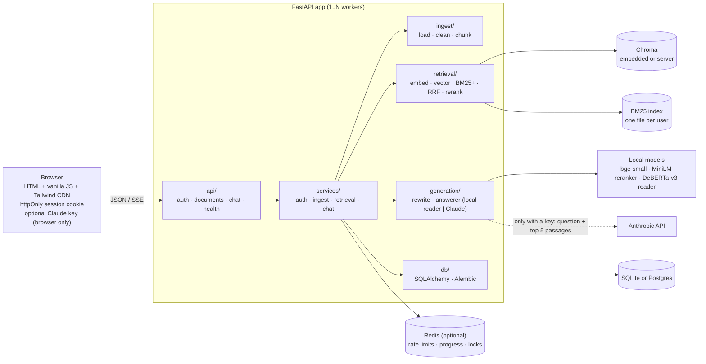

<p align="center">
  <picture>
    <source media="(prefers-color-scheme: dark)" srcset="assets/brand/wordmark-dark.svg">
    
  </picture>
</p>

<p align="center"><strong>Chat with your PDFs. Every answer links to the exact page it came from, and when the documents don't contain the answer, it says so instead of guessing. Works with no API key.</strong></p>

<!-- DEMO GIF PLACEHOLDER: record "Try it with a sample PDF" → click a sample question → click a [1] chip → ask a follow-up → toggle "Show retrieval scores", save as docs/demo.gif, and replace this comment with:  -->
> 📽️ *Demo GIF goes here (`docs/demo.gif`).*

```bash
cp .env.example .env
docker compose up --build      # → http://localhost:8000, click "Try it with a sample PDF"
```

---

## Features

- **Answers on its own, no API key needed.** A built-in extractive question-answering model (`deepset/deberta-v3-large-squad2`) reads the retrieved passages and quotes the exact sentence that answers the question, with the answer in bold and a page citation. Because it quotes rather than writes, it can't put words in the document's mouth. It is also trained to say "no answer", and it does when it isn't confident.
- **Or bring your own Claude key.** Paste an Anthropic key in **Settings** for written, summarised answers. The key is tested instantly (free Models API call), kept only in your browser, sent with each question and never stored or logged by the server. Remove it to go back to the built-in model.
- **Follow-up questions just work.** "How long is the warranty?" → "Can it be transferred?" is turned into a standalone search, by Claude when a key is set or by a keyword heuristic otherwise. The UI shows what it searched for.
- **Hybrid retrieval:** dense vectors (`bge-small-en-v1.5`, Chroma) plus BM25+ keywords, merged with Reciprocal Rank Fusion, then reranked by a cross-encoder.
- **Two-layer "I couldn't find this":** a relevance gate refuses off-topic questions before any model runs. Then either the local model's confidence and answer-type checks, or Claude's `NO_ANSWER` rule, catch the near misses.
- **Sign in or try as a guest:** email and password (argon2id, httpOnly cookie sessions), or one click into a guest account with a sample PDF already indexed. Guest data is deleted after 24 hours.
- **Visible upload progress** (Reading → Splitting → Understanding → Ready), friendly errors, retry for failed files, and per-user duplicate detection.
- **Per-user isolation:** every vector and keyword search is filtered by user, and this is covered by tests.
- **Conversation history** with rename and delete; scope questions to selected documents.
- **Transparent retrieval:** a debug switch shows vector, BM25, RRF and rerank scores for every source.
- **Scales out:** Alembic migrations, Postgres, and Redis-backed rate limits, upload progress and locks, plus a Chroma server for running several workers (`docker-compose.scale.yml`).
- **Design system:** warm-paper and teal tokens, light and dark themes, WCAG AA contrast checked by a script, keyboard shortcuts, reduced motion respected, usable at 360 px. See [`/static/styleguide.html`](app/static/styleguide.html).
- **Measured, not claimed:** `scripts/evaluate.py` (free, no key) and `scripts/judge.py` (LLM-as-judge, needs a key).

## Architecture



**Layering rule:** `api → services → (ingest | retrieval | generation | db)`. Lower layers never import upper ones, and services never import FastAPI.

**Ask flow:**
1. Follow-up? Rewrite it into a standalone query.
2. Embed the query (with bge's query prefix).
3. Search vectors (top 20) and BM25 (top 20), both filtered by `user_id`.
4. Merge with RRF (k = 60), then rerank with the cross-encoder and keep the top 5.
5. **Gate:** if the best rerank score is below `MIN_RERANK_SCORE`, answer "couldn't find this".
6. Answer with an engine:
   - **Local reader:** for each passage, take the best span and score it as model confidence + rerank weighting. Check the answer type, then quote the sentence. If not confident, return `NO_ANSWER`.
   - **Claude:** a numbered-sources prompt, with a reply of exactly `NO_ANSWER` when the sources aren't enough.
7. Stream tokens → `citations` event → persist → `done`.

## Evaluation

The corpus is two original manuals written for this project and generated by `scripts/make_sample_pdf.py`:
- a 10-page home-battery handbook;
- an 8-page EV-charger guide, a deliberate **hard distractor** that covers the same topics (Wi-Fi, warranty, status lights, even the same error code `E-214`).

A question counts as answered correctly only if the reply contains the expected fact **and** cites the expected page.

```bash
python scripts/evaluate.py          # all tables below (free, deterministic, no API key)
python scripts/evaluate.py --sweep  # + per-question scores and threshold sweeps
python scripts/evaluate.py --eval-set tests/heldout_set.json
```

### Development set (`tests/eval_set.json`: 30 answerable, 8 unanswerable, 10 follow-ups)

| Config | Hit@1 | Hit@5 | MRR | Fallback accuracy | Latency / query (CPU) |
|---|---|---|---|---|---|
| Vector only | 0.80 | 0.97 | 0.88 | n/a | 10 ms |
| Hybrid (RRF) | 0.93 | 1.00 | 0.95 | n/a | 11 ms |
| Hybrid + Rerank | 1.00 | 1.00 | 1.00 | 0.87 | 139 ms |

End-to-end answers with the **built-in model, no API key**:

| Answerable: correct fact + page | Answered wrongly | Refused but answerable | Unanswerable: correctly refused | Overall accuracy | Latency / question (CPU) |
|---|---|---|---|---|---|
| 30/30 (100%) | 0 | 0 | 8/8 | 100% | 1489 ms |

| Follow-ups | Hit@5 | Answer correct (fact + page) |
|---|---|---|
| Follow-up as typed | 1.00 | 0.70 |
| With query rewriting | 1.00 | 1.00 |

The result is the same at every reader threshold from −6 to +4, so it isn't balanced on a single tuned value.

### Held-out set (`tests/heldout_set.json`: 14 answerable, 4 unanswerable)

These questions were written **after** every model and threshold choice was made, and run once:

| Answerable: correct fact + page | Answered wrongly | Refused but answerable | Unanswerable: correctly refused | Overall accuracy |
|---|---|---|---|---|
| 13/14 (93%) | 1 | 0 | 4/4 | 94% |

The one miss: "Which safety standards does the H2 comply with?" was answered with the enclosure's IP56 rating from a lower-ranked passage. The right passage was ranked first, but the reader preferred a confident span elsewhere.

### How the built-in model was chosen (development set, identical final pipeline, `READER_MODEL=…`)

| Reader model | Parameters | Answerable correct | Unanswerable refused | Overall | Latency / question (CPU) |
|---|---|---|---|---|---|
| `deepset/roberta-base-squad2` | 125M | 27/30 | 7/8 | 89% | 410 ms |
| `deepset/deberta-v3-base-squad2` | 184M | 26/30 | 8/8 | 89% | 481 ms |
| **`deepset/deberta-v3-large-squad2`** (default) | 435M | **30/30** | **8/8** | **100%** | 1489 ms |

Latency covers the whole pipeline (retrieval, rerank and reader).

**Read this honestly:** the corpus is small and synthetic, and I wrote the documents and questions. Several design choices (model, rerank weighting, answer-type check, yes/no rule) were made while looking at the development set, which is why the held-out number is the one to trust. **No system is 100% accurate on every PDF.** What this design guarantees is narrower and more useful:
- the built-in model only ever **quotes your document verbatim**, with a link to the page so you can check;
- it **declines** when it isn't confident instead of inventing an answer.

### LLM-as-judge (needs a key)

```bash
ANTHROPIC_API_KEY=sk-ant-... python scripts/judge.py --answerer local    # grade the built-in model
ANTHROPIC_API_KEY=sk-ant-... python scripts/judge.py --answerer claude   # grade Claude's written answers
```

It runs the full pipeline, then a judge model (default `claude-opus-5-5`) grades each reply. It reports **correctness** against the reference facts, **faithfulness** (every claim supported by the cited passages) and **refusal accuracy**, i.e. how often "I couldn't find this" is the right call. It makes paid API calls; `--limit N` tries it on a few questions first. *Not run for this README: no API key was available on the build machine.*

## Design decisions

| # | Decision | Why |
|---|---|---|
| 1 | **Hybrid + rerank over vector-only** | Measured above (Hit@1 0.80 → 1.00). Vectors handle paraphrases; BM25 nails exact tokens (`E-214`, `HB-WM2`, port `502`); the cross-encoder fixes ordering. |
| 2 | **Local embeddings and a local answer model** | Privacy and zero cost. With no key, nothing leaves the machine. With a key, only the question and the top 5 passages go to Anthropic. |
| 3 | **Extractive reader rather than a small local generative model** | An extractive model can only return text that's in the PDF, which is the strongest accuracy guarantee available without an LLM. It's trained on SQuAD 2.0, which includes unanswerable questions, so "no answer" is a first-class output. A small generative model would write fluent text and hallucinate more. Answers are less polished than Claude's; that trade-off is the point of making Claude optional. |
| 4 | **No "training" on your PDFs** | RAG doesn't need it: the model is pretrained to find answers in any text, and retrieval supplies the right text. Fine-tuning on a few PDFs would overfit. What is tuned is the thresholds, by measurement. |
| 5 | **Rerank weighting + answer-type check + yes/no rule** | Each fixes a measured failure. Weighting by rerank score stopped "red light on the *battery*" being answered from the *charger* manual. The type check makes price questions require money and "how many" require a number, which stopped "cost?" being answered with the weight. Yes/no questions also quote the next sentence, where qualifiers like "not suitable" usually are. |
| 6 | **SQLite + Chroma by default, Postgres/Redis/Chroma server when scaling** | Zero ops for one container; the same code runs multi-worker by setting three URLs. |
| 7 | **httpOnly cookie over a localStorage JWT** | Scripts (including XSS) can't read the session. SameSite=Lax plus a required `X-Requested-With: fetch` header blocks CSRF; no CORS is enabled. |
| 8 | **Threshold before any model** | Cheaper and more reliable than relying on refusal alone. -5.0 is the highest gate value that refused no answerable development question. |
| 9 | **800/150 character chunks, RRF k = 60** | One fact plus its context per chunk; whole-sentence overlap; RRF needs no score normalization. |
| 10 | **No JS framework** | No build step; `app/static/js/` reads in minutes. |

### Choices made along the way (and experiments that lost)

- **Plain-text extraction beat block extraction.** Splitting pages into layout blocks keeps headings separate, but it scored lower: rerank Hit@1 fell to 0.97, and answers 29/30 instead of 30/30. A heading running into its first sentence gives the chunk useful topic context. So the loader keeps `get_text("text")`.
- **BM25+ instead of BM25Okapi:** Okapi's IDF goes negative on tiny per-user corpora (a test caught a one-chunk document scoring below zero). BM25+ keeps it positive, and only chunks containing a query term are returned.
- **Follow-up rewriting without a key** is a heuristic: when a question leans on context (pronouns, "and…", "what about…", very short), the previous question's key terms are added to the *search* query only. Measured: follow-up answers go from 0.70 to 1.00.
- **Auto engine selection** (`LLM_PROVIDER=auto`): the user's key → Claude; else the server's key → Claude; else the built-in model. `local` and `anthropic` force one engine.
- **Multi-worker correctness:** per-user BM25 files are written atomically and reloaded when another worker changes them (mtime check). Index rebuilds take a per-user Redis lock. Embedded Chroma is single-process, so multi-worker mode requires `CHROMA_URL`; Compose runs the Chroma server from the same image, so client and server versions always match.
- **Migrations:** startup runs `alembic upgrade head`. Databases created by earlier versions (tables but no `alembic_version`) are stamped rather than recreated, so data is kept; tested.
- **Contrast fixes:** token values were adjusted (not the rule) where `check_contrast.py` failed, and a `--color-border-input` token meets WCAG 1.4.11.
- **`requirements.lock`** is resolved for the container target (CPython 3.11, Linux) by `scripts/lock.py`. A dev-machine `pip freeze` (Python 3.12) pinned packages that don't install on 3.11.
- **Logo:** an original mark (a document with a "verified answer" bubble) in the design tokens' teal and amber, flat. The in-app version is an inline SVG coloured by tokens, so it follows the theme. Standalone files are in `assets/brand/`.

## Run it

### Docker (one container)

```bash
cp .env.example .env
docker compose up --build
```

Open http://localhost:8000 → **Try it with a sample PDF**, or create an account. It answers immediately with the built-in model. For Claude answers, open **Settings** and paste your key. The image bakes in all models (about 2.5 GB in total), so later starts work offline. For a public deployment set `APP_ENV=prod` and a random `SECRET_KEY` (the app refuses to start with a placeholder), and serve it over HTTPS.

### Docker (multi-server: Postgres + Redis + Chroma server + 2 workers)

```bash
docker compose -f docker-compose.yml -f docker-compose.scale.yml up --build
```

Each worker loads the models (about 2.5 GB RAM each with the large reader). Set `WEB_CONCURRENCY` to fit your RAM, or `READER_MODEL=deepset/deberta-v3-base-squad2` for a lighter worker.

### Local development

Python 3.11+.

```bash
python -m venv .venv
source .venv/bin/activate            # Windows: .venv\Scripts\activate
pip install -r requirements-dev.txt
cp .env.example .env
uvicorn app.main:app --reload        # http://localhost:8000, API docs at /docs
```

The first start downloads the models from Hugging Face.

### Checks

```bash
ruff check . && ruff format --check .
pytest -W error::DeprecationWarning       # unit + integration + isolation + backends
python scripts/check_contrast.py          # WCAG AA for every token pair, both themes
python scripts/evaluate.py                # retrieval, answer accuracy, follow-ups
grep -rni gradient app/static             # must print nothing
```

Backend tests use `fakeredis` by default. Set `TEST_REDIS_URL`, `TEST_DATABASE_URL` and `TEST_CHROMA_URL` to run them against real servers; CI does this for Postgres and Redis.

### Publishing to GitHub

`.env`, `data/` and `.venv/` are git-ignored, so no key or user data is committed. To publish:

```bash
git remote add origin https://github.com/<you>/rag-chat.git
git push -u origin master
```

CI then runs lint, contrast, the no-gradient check, migrations, and the tests against real Postgres and Redis.

## API

| Method | Path | Purpose |
|---|---|---|
| POST | `/auth/register`, `/auth/login`, `/auth/guest`, `/auth/logout` | sessions (httpOnly cookie) |
| GET | `/auth/me` | current user |
| POST | `/documents` | upload a PDF (multipart) → `202` with `status: processing` |
| GET | `/documents` | the user's documents |
| GET | `/documents/{id}/status` | `{status, stage, progress, error}` |
| POST | `/documents/{id}/retry` | re-run ingest for a failed document |
| DELETE | `/documents/{id}` | removes the row, chunks, BM25 entries and file |
| POST | `/chat/ask` | SSE: `rewrite`?, `token`*, `citations`, `done {answer, answerable, engine, …}` (or `error`) |
| GET / PATCH / DELETE | `/conversations`, `/conversations/{id}` | history, rename, delete |
| POST | `/llm/check` | which engine will answer, and does it work? |
| GET | `/health` | database, Redis and model status |

Every error has the shape `{"error": {"code": "...", "message": "human readable"}}`. Other users' resources return **404**. State-changing requests need `X-Requested-With: fetch`. The optional `X-Anthropic-Api-Key` header selects Claude for that request.

## Project structure

```
app/
  api/          auth.py documents.py chat.py health.py deps.py
  services/     auth_service.py ingest_service.py retrieval_service.py chat_service.py
                container.py rate_limit.py coordination.py
  ingest/       loader.py cleaner.py chunker.py
  retrieval/    embedder.py vector_store.py bm25_store.py hybrid.py reranker.py
  generation/   answerer.py reader.py rewrite.py prompt.py llm_base.py llm_anthropic.py llm_fake.py factory.py
  db/           models.py session.py repositories.py
  static/       index.html styleguide.html css/{tokens,components}.css js/{api,state,ui,chat,app}.js
migrations/     Alembic env + versions
assets/brand/   logo and wordmarks
tests/          unit, API, backends, eval_set.json, heldout_set.json
scripts/        evaluate.py judge.py check_contrast.py make_sample_pdf.py lock.py
```

## Limitations

- **Accuracy depends on the document:** the built-in model quotes one passage. Questions that need combining facts from several places, or reading tables, get partial answers; Claude handles those better.
- **Scanned PDFs are rejected** (no OCR); tables and multi-column layouts are flattened to text.
- **English-only models** (bge-small-en, MiniLM reranker, DeBERTa reader).
- **CPU latency:** about 1.5 s per question for the large reader on a laptop CPU; use the base reader for speed.
- **chromadb 1.5.9 has open advisories** (`pip-audit`: PYSEC-2026-311, -3813, -3814, -3815; no fixed release listed yet). Upgrade when one ships.
- **Tailwind's Play CDN** is documented as development-only; it is used only for layout utilities.

## Credits

- Built-in answer model: [`deepset/deberta-v3-large-squad2`](https://huggingface.co/deepset/deberta-v3-large-squad2) by deepset, licensed **CC BY 4.0**.
- Embeddings: `BAAI/bge-small-en-v1.5`. Reranker: `cross-encoder/ms-marco-MiniLM-L-6-v2`.

## Future work

1. Multi-passage answers for the built-in model (combine spans from several sources).
2. Run `scripts/judge.py` regularly and add its numbers here.
3. OCR fallback for scanned pages; an in-app PDF viewer that jumps to the cited sentence.
